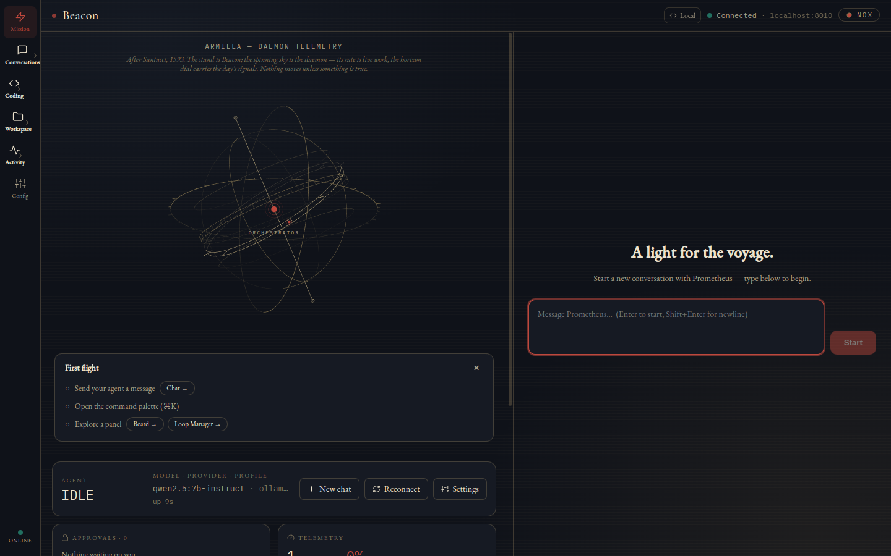
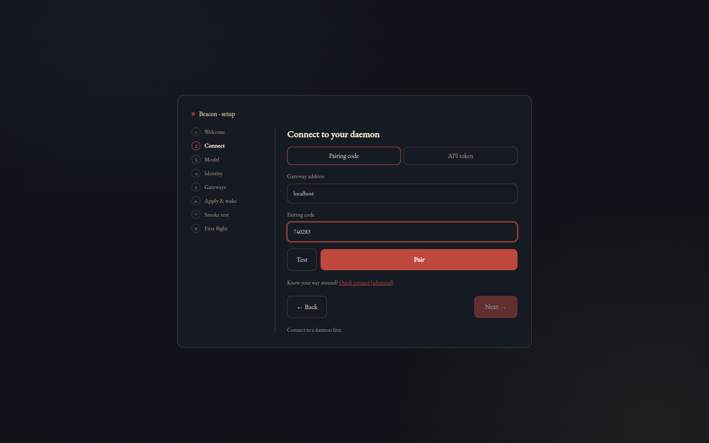
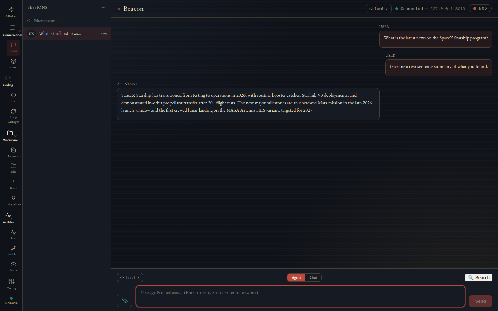
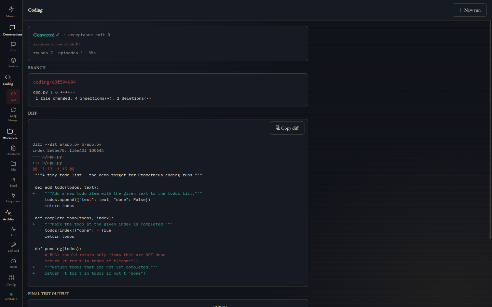
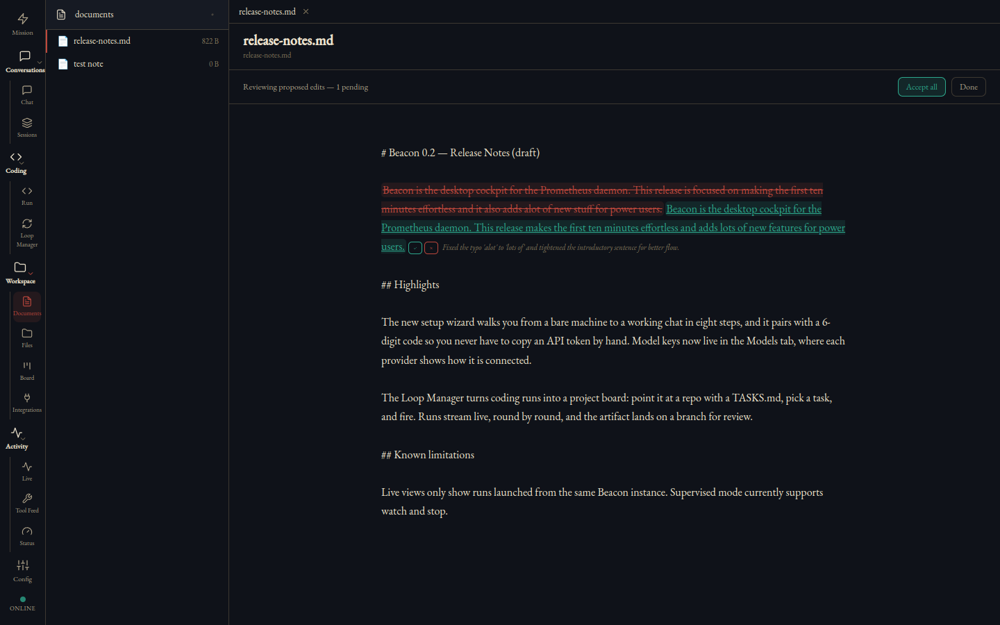
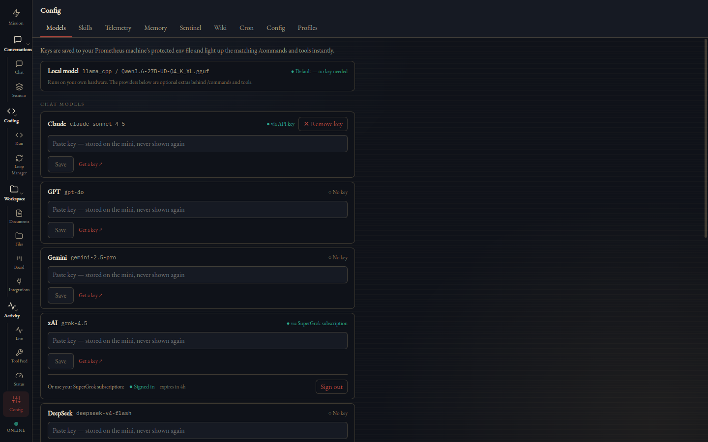
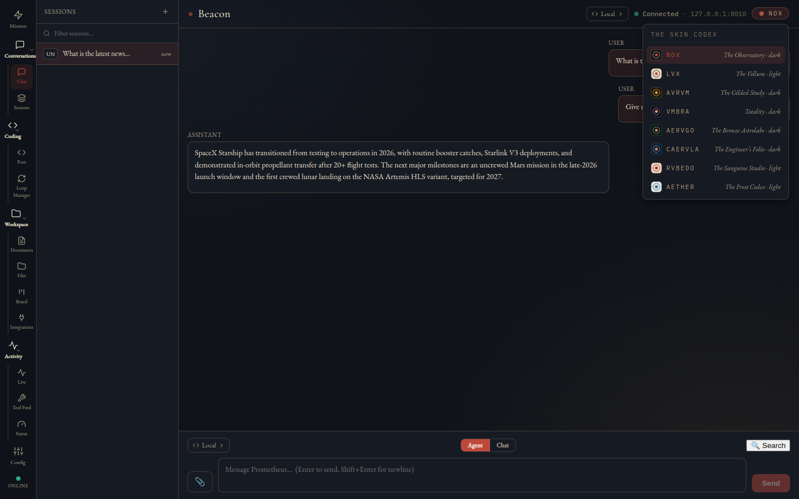
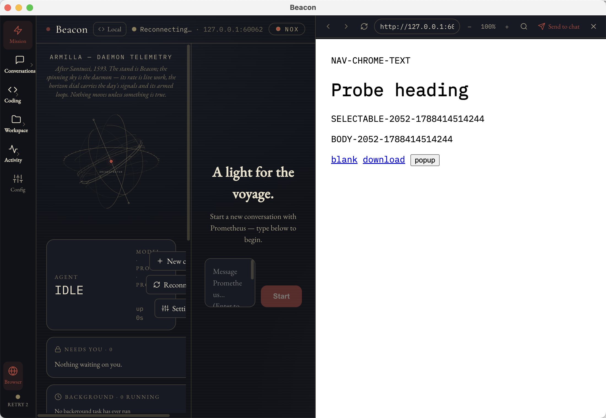

# OAra Beacon

The native desktop cockpit for **[Prometheus](https://github.com/OAraLabs/Prometheus)** — a local-first AI agent daemon. Beacon is a pure client (Electron + React): no bundled backend, no model keys on disk; the daemon stays the single source of truth. It pairs with a 6-digit code, talks REST (`:8005`) + an authenticated WebSocket (`:8010`), and works the same whether the daemon is on `localhost` or across your tailnet.



The full view-by-view tour lives in the Prometheus repo: **[Beacon guide](https://github.com/OAraLabs/Prometheus/blob/main/docs/guide/beacon.md)** · [Install & pairing walkthrough](https://github.com/OAraLabs/Prometheus/blob/main/docs/guide/install.md).

## Install

Prebuilt downloads are on this repository's **[Releases](https://github.com/OAraLabs/beacon/releases/latest)**
page, which is also the update feed; [docs/SETUP.md](docs/SETUP.md) walks through installing and
connecting. To build from source, see [Commands](#commands) and
[Packaging](#packaging); `npm run dist` emits the same artifacts CI attaches to draft releases:

- **macOS** — `Beacon-<version>-arm64.dmg` (Apple Silicon only; Intel Macs are not built,
  see `mac.target` in `electron-builder.yml`), drag Beacon to Applications. A local build without
  signing credentials is **unsigned**, so Gatekeeper will balk the first time: right-click the app →
  **Open** → **Open** once (or `xattr -dr com.apple.quarantine /Applications/Beacon.app`).
- **Linux (AppImage)** — `Beacon-<version>-x86_64.AppImage`, then
  `chmod +x Beacon-*.AppImage && ./Beacon-*.AppImage`. Universal; no install step.
- **Linux (deb)** — `sudo apt install ./Beacon-<version>-amd64.deb` (or
  `sudo dpkg -i` + `apt -f install`).

On first launch Beacon opens the **setup wizard** — eight steps from a bare daemon to a working chat. Run `prometheus daemon` on the host; in setup mode it prints a one-time pairing line (`address <host>:8005 · code ######`). Enter the host and the 6-digit code, and the wizard walks connect → model detection → identity → gateways → apply & wake → a real smoke-test round-trip. Already have a token? The **Quick connect (advanced)** escape hatch takes `address + token` directly.



## What's in the window

A six-entry nav rail that never expands — **Mission** · **Chats** · **Coding** · **Workspace** · **Activity** · **Config**. A surface's second level is a pill row at the top of the surface, not a tree in the rail: Chats (Chat, Sessions) · Coding (Run, Loop Manager) · Workspace (Files, Documents, Wiki, Artifacts, Checkpoints, Board, Skills, Integrations, Devices) · Activity (Live, Tool Feed, Status).

### Chat with a live tool timeline

Streaming markdown (GFM, syntax highlighting, collapsible code blocks), per-turn **tool-call chips with live durations** (parallel dispatches render as `‖N` batches), retry/edit-last, attachments via picker/paste/drag-drop. The composer carries a **per-session model switcher** (with auth-mode badges), the **Agent | Chat** mode toggle (tools vs plain reply), and the **🔍 force-search** toggle that arms the next message to start with a real web search. Long transcripts stay fast: only the recent tail is mounted (**Show earlier** reveals the rest on demand), so a session that has run for months doesn't render thousands of markdown trees to show you the last reply. Relaunching reopens the session you were last in.

While a turn runs, the **ActivityLine** narrates it — a live "◐ Rummaging… 47s · bash · round 2" that advances only on real daemon frames, never a CSS timer: **movement means liveness**, so if the link dies the line visibly freezes instead of spinning reassuringly. When the agent leaves files in its outbox, the reply grows **download chips** — click to fetch the file by content id and save it to Downloads. And long turns stay readable: past six tool calls the strip collapses to a **per-tool tally** that keeps running/error state visible.



### A sidebar that scales past 100 sessions

Every session carries a **readable source chip** — Desktop, Telegram, Voice, Slack, and friends — and the list groups by recency: **Today / Yesterday / Earlier this week / Older**, bucketed by calendar day so "yesterday" means yesterday even at 00:20. Machine runs (bakeoff, verify, and eval harnesses) fold into a single dashed **Automated** chip excluded from the default view — the audit trail stays one click away without competing with real conversations. **Forget** removes a session durably on the daemon, not just locally; a forgotten session that speaks again revives rather than staying silently buried. Unread dots ride a per-session watermark (the daemon's high-water rowid), so a session that moved while Beacon was closed still shows as unread on a cold start. Subagent sessions nest under their parent rather than flattening into the list — the **Sessions** view renders the whole tree.

### Coding runs & the Loop Manager

Fire **sandboxed iterate-to-green coding runs** on the daemon and watch rounds stream live (tokens, duration, thinking flag). The terminal state is a verdict — acceptance exit code, branch, and a colorized diff. **Review-only: Beacon never merges or pushes** — and that's asserted, not just documented: `smoke:coding` exits non-zero if a `git merge` or `git push` ever shows up in the generated review commands. Runs are capped by default at **30 rounds / 1200s wall** (the daemon's own defaults), editable per run. The Loop Manager adds a PM cockpit above it: register repos, keep a `TASKS.md` board, edit the `LOOP.md` contract, and fire in Autonomous / Composed / Supervised mode — or start from nothing and let a loop **bootstrap a brand-new project** from the board. `TASKS.md` is rewritten byte-faithfully (only the task's own line changes), and both Loop and Documents are confined to allowed paths under the project root.



### Documents with AI redlines

A calm writing surface over the daemon's documents folder — auto-save, multi-tab, and **Ask AI**: describe a change and review the proposed edits as inline tracked-changes with per-edit Accept/Reject. Nothing touches disk until you accept.



### Mission Control, feeds, and the Board

**Mission** is the cockpit home: agent state, model/uptime, actionable approvals, telemetry headline, task ticker, and the Armilla — a telemetry-driven armillary sphere whose motion is live daemon work. At its center sits the **Attention inbox**: one ranked queue for everything blocked on you — exec approvals first (the agent is stopped, waiting on consent), then stalled sessions, then failed sends. That composed queue is what Mission's "needs you" card renders; the tray HUD reads the same approval and failed-send surfaces so you can check the count without summoning the window, but stalled sessions live in the main window's renderer store and aren't mirrored there yet. **Live** streams every gateway frame (filter, search, export, and **pause** — which freezes the rendered snapshot so a busy agent can't scroll the thing you're reading off the screen). **Tool Feed** aggregates tool calls across sessions with success stats. **Status** is the read-only instrument panel: agent status, a **context inspector** for the live session's window, the Sentinel dream log, and the daemon's profiles, all polled every 4s. **Board** is a daemon-backed Kanban whose stories can be dispatched straight into coding runs. Mission's models card reports **how many of your configured models are actually reachable** (`N/M ready`), so a dead endpoint or a missing key reads as unavailable up front rather than failing at send time.

### Models & keys, without touching a config file

Config → **Models** manages every provider key over the daemon's REST (paste once — live immediately, never displayed again), links each provider's console, and shows **how** each one is connected. xAI supports **"Sign in with SuperGrok"** — an OAuth device flow that uses your subscription instead of an API key.

Config → **Cron** is a real scheduler, not a viewer: create a job (name + schedule + command), **Run** it now fire-and-forget, enable/disable it, or delete it — every write re-reads `/api/cron`. The schedule is sanity-checked client-side and fully validated by the daemon. Armed jobs also show up on the Armilla as diamonds parked at their firing hour, so the dial reports schedules rather than only history.

**Integrations** is deliberately generic (contract v0.1): every view renders from a manifest plus wire schemas, with *no* integration-specific code in Beacon. If a control surface can't be expressed in the contract, that's a contract gap to fix — not a special case to hard-code. New integrations need no Beacon release.



### Memory you can edit

Config → **Memory** is an editor, not a viewer: the agent's `MEMORY.md` and `USER.md` are editable in place, with a live character meter against the daemon's budget. Saves are conflict-safe — if the agent wrote memory while you were typing, the save is rejected (409) and comes back with the current truth so your draft rebases on top of it; a stale save can never clobber. The daemon snapshots the previous content before every write, so there's history behind every edit.

### Nine themes — the Skin Codex

NOX (The Observatory, default) · NIGREDO (The Camera Obscura) · LVX (The Vellum) · AVRVM · VMBRA · AERVGO · CAERVLA · GLAVCVM (The Herbarium) · AETHER — nine plates, live-preview tiles, one click, persisted. Plus **SYSTEMA**, a tenth choice that follows the OS appearance and re-skins live between NOX and LVX as the system flips light/dark. Every informational color pair in every plate is measured by `npm run lint:contrast`, not eyeballed.



### The sessions panel

264px beside the thread. Three scopes — **All · Unread · Voice**, each with its count — and a
filter button that opens the source facets (Beacon, iOS, Desktop, Web, Telegram, Automated,
Harness, Unlabelled) in a popover, because source is a facet, not a top-level mode. Rows are
compact (28px): source tag · title · unread dot · time. The footer is the open conversation's
context meter (`2.2k / 33k ctx · 7%` over a bar), with the full breakdown one click away on
Status.

### Mission

Two columns: the Armilla with a four-pair legend (SPIN · NODES · DIAL · FROZEN — the only place
the "motion is telemetry" contract is written down), and the HUD beside it. Every card sizes to
its content, and an empty card is one row (`NEEDS YOU · Nothing waiting on you. · 0`). One
accent per region: **New chat** is the page's primary action; status keeps its own scale (teal
healthy, lapis for a pending permission or a secondary link, sanguine for error).

### Config → Models

The backend registry is a table — host · runtime/model · endpoint · window · latency · state ·
fresh · Probe — with reachability and freshness in separate cells, a `N pulled` chip that
expands, and one summary line up top (`2 backends stale · 3 providers without a key`) with a
**Show only problems** filter. Providers are one row each (name · model · key state · Add /
Replace key); the key field opens only on demand.

### The dock: an inspector, a browser and a terminal beside the conversation

The chat view has exactly **one** right-hand dock — the conversation stays, the dock opens beside
it, like Claude Code's desktop layout. It hosts one pane at a time (a three-way split is unusable
at these widths): the **inspector** (a tool call's arguments and result, a file, a rendered
artifact), the **browser**, or the **terminal**. One segmented control in the thread header —
adjacent to the pane it opens — picks which; `⌘1` / `⌘2` / `⌘3` toggle them from any view, `Esc`
closes, and the composer's **Browser** / **Terminal** buttons open the two you would hand
something to the agent from. The dock is deliberately *not* reachable from the rail: a trigger at
the far-left edge that opens a pane at the far-right edge was the defect this replaces. Opening
the browser or terminal collapses the session list so the thread keeps its reading width; the
inspector does not. The dock collapses by default, and its width is a draggable divider that
persists. Switching panes never reloads the browser page or restarts a shell: the hidden pane is
*hidden* — for the browser that means the native view's rect is zeroed, not merely painted over.
Each pane pops out to its own window from the dock and comes back to it.

### A browser pane you drive — the agent cannot

`⌘2` (or the dock group's globe, or the composer's **Browser**) opens the dock on a web view beside the chat:
URL bar, back / forward / reload / stop, zoom, find-in-page, and readable error pages for a name
that does not resolve, a refused port, or a bad certificate. **Send to chat** puts the page's
URL and your selection (or its readable text, truncated with a visible marker) into the composer
as *your* message — you send it, or you don't. The composer is right there: that is why the pane
lives beside the conversation rather than replacing it.



Tabs: a strip above the toolbar — new, close, click to switch, drag to reorder — and a
page's `window.open` / `target=_blank` opens a new tab here rather than leaving the app.

It pops out into its own window (bounds remembered) and back: the web contents *move* between
windows — nothing reloads, history and scroll survive — and closing the pop-out reattaches
rather than losing the page. Send to chat works from the pop-out too; the block goes to the
main window's composer. The satellite window is `src/main/popout-window.ts`, built so the
terminal pane can pop out the same way.

It is a **human viewer**, deliberately: the page lives in a `WebContentsView` owned by the main
process, in its own in-memory session (no cookies shared with the shell, nothing persisted
across launches), with no preload and no bridge. Permission requests are denied without a
prompt and the pane says so; downloads are blocked and named; `window.open` opens
a new tab, never a popup. There is **no IPC path from a chat or agent message to this
view's navigation or execution** — `smoke:browser-invariant` asserts that on the source and
plants fourteen such wirings to prove it can see them. Agent browsing stays the daemon's gated,
audited `browser` tool.

### Cross-cutting

`⌘K` command palette with deep links into every Config surface · `⌘⇧Space` global quick-capture composer (same send path as Chat — cache, outbox, durable re-key) · exec-approval overlay with native notifications + tray badge · hide-to-tray (the connection survives — and a first-time coach says so, with a Settings switch to make ✕ quit instead) · launch at login (macOS/Windows, packaged builds) · per-kind notification preferences (approvals, replies, tasks, disconnections, plus a master mute) so a busy install can quiet the noise WITHOUT giving up the blocked-agent alert · a Skin Codex of nine plates plus SYSTEMA (follow the OS light/dark) · offline outbox that drains on reconnect · a connection indicator that shows an **amber lock when REST is auth-rejected** so "connected" can't lie · zoom (`⌘+` / `⌘-` / `⌘0`) that survives a restart, which Electron otherwise resets to 100% on every launch.

Exec approvals are **binary and global**: the daemon's queue is approve/deny (no web-style allow-once / always-allow), and a pending action isn't scoped to a session — so it surfaces wherever you are, not only in the conversation that triggered it.

A rejected bearer renders as **one** state everywhere — REST 401 and WS 4401 both land on the same "not authorized" surface across panels, the socket, and the file preview — so a bad token never masquerades as an empty workspace.

In the menu bar, the tray icon is the **Pulse** mark — a Retina template icon that recolors to match a light or dark bar on macOS — with a live status tooltip (idle / thinking / tool running / error) and a click-to-open HUD: connection state, daemon status and uptime, pending-approval and failed-send counts, and the last gateway event, all without summoning the window.

## Connection setup

First run asks for the gateway address (host/IP; ports are fixed `:8005` REST / `:8010` WS)
and the optional `PROMETHEUS_API_TOKEN`. **Test** probes `GET /api/status` and the WS
first-frame handshake with the typed values before anything is saved; **Connect** stores the
address in app-data and the token in the OS keychain (via `safeStorage`) — the token value
never reaches the renderer again. Beacon presents the token on the WebSocket's first frame;
current daemons require it (close code 4401 otherwise). Reconfigure anytime with `⌘,`
(Settings…), which has the same Test/Save-and-test flow and reports REST and WS as distinct
results.

The link also can't lie about being alive. A half-open socket — the machine slept, a NAT or
tailnet path dropped — dies without ever delivering a close event, so without probing,
"Connected" could point at a dead socket indefinitely. Beacon pings the WebSocket every 20
seconds and terminates it after 45 seconds of silence, routing straight into the normal
reconnect backoff; opening the laptop lid triggers an immediate redial (`powerMonitor`).
And a send that fails while the indicator says connected surfaces an error in the chat
instead of silently queueing.

Pairing refuses to false-succeed. A daemon that answers `200` **without** a token is an
error, not a silent empty-token pair; a wrong code reports how many attempts remain, and
locked / expired / already-used each say which. After a successful pair the only thing that
ends the wait is the real daemon answering `GET /api/status` — a setup server that merely
disappeared mid-restart keeps waiting rather than proceeding on a guess. On Linux without a
secret service (headless session, no gnome-keyring) `safeStorage` would throw and hard-wall
first-run Connect, so Beacon falls back to Electron's sanctioned `basic_text` backend —
Linux-only by construction, since the call throws on macOS/Windows where the keychain always
exists.

The window paints from a local SQLite cache immediately, then reconciles against the daemon
by a durable **rowid cursor** — fetching only what it hasn't already stored. Your own message
renders optimistically and is re-keyed to its durable rowid when the daemon echoes it back
(matched on `client_msg_id`), so the row you're looking at becomes the real row rather than
being replaced by a duplicate. The cache is a read-through cache and a write-behind outbox,
never a second source of truth.

## Keyboard shortcuts

| Keys | Action |
|---|---|
| `⌘K` / `Ctrl+K` | Command palette (views, sessions, actions) |
| `⌘,` / `Ctrl+,` | Connection settings |
| `?` | Shortcut sheet (outside inputs) |
| `Enter` / `Shift+Enter` | Send / newline |
| `Esc` | Close palette / sheet / popover / quick capture / the dock |
| `⌘1` / `Ctrl+1` | Open / close the inspector pane (the dock, beside the chat) |
| `⌘2` / `Ctrl+2` | Open / close the browser pane (same dock) |
| `⌘3` / `Ctrl+3` | Open / close the terminal pane (same dock) |
| `⌘L` · `⌘F` · `⌘[` `⌘]` · `⌘R` | In the browser pane: address bar · find · back/forward · reload |
| `⌘⇧B` / `Ctrl+Shift+B` | Summon Beacon from anywhere (global) |
| `⌘⇧Space` / `Ctrl+Shift+Space` | Quick-capture mini composer (global) |

## Layout

```
src/
  main/        Electron main process (Node) — owns the connection, SQLite cache, IPC
  preload/     contextBridge — the ONLY renderer↔Node surface (allowlisted)
  renderer/    Vite + React UI
  shared/      IPC channel + payload contracts shared by all three
scripts/       maintenance/proof scripts: lints, probes, release tooling
docs/          README screenshots
```

## Commands

```bash
npm install            # also rebuilds better-sqlite3 for Electron's ABI (postinstall)
npm run dev            # electron-vite dev (needs a display)
npm run build          # build main + preload + renderer into out/
npm run typecheck      # tsc for the node (main/preload) and web (renderer) projects
npm run lint:tokens    # design-token lint — no hardcoded colors outside theme/tokens.css
npm run verify         # typecheck + lint:tokens + build (the per-change gate)
npm run rebuild        # manual better-sqlite3 rebuild (only if postinstall was skipped)
npm run sqlite:proof   # headless proof that better-sqlite3 loads under Electron's ABI
npm run dist           # package a distributable for the current platform — see Packaging below
npm run dist:mac       # build + package the macOS .dmg explicitly
npm run dist:linux     # build + package the Linux AppImage + .deb explicitly
```

### Smokes

**36 `smoke:*` scripts** — headless proofs (`ELECTRON_RUN_AS_NODE`), run after
`npm run build`. Beacon has no component-test framework, so shared logic (timeline
batching, session grouping, attention ranking, presence) is written pure specifically
to be provable headless. Most smokes are pure/stubbed; `step2`/`step4` exercise the
LIVE daemon end-to-end and need a bearer + a patient timeout when the model backend
is slow:

```bash
set -a; . ~/.config/prometheus/env; set +a       # exports PROMETHEUS_API_TOKEN for live smokes
BEACON_SMOKE_REPLY_TIMEOUT_MS=420000 npm run smoke:step2
npm run smoke:step4 / step5 / step6              # cache, creds, tray/unread
npm run smoke:parts / approval / attachment / forget / panels
npm run smoke:trust / timeline / palette
npm run smoke:ws-liveness / activity-frames / session-groups / session-sources / order / real-history
npm run test:markdown                            # gfm + syntax-highlight rendering
```

The browser pane has two smokes and a real-app probe. `smoke:browser` covers its pure layer;
`smoke:browser-invariant` (also in `verify:quick`) asserts on the source that no chat/agent
message can reach the view's navigation or execution, then plants fourteen such wirings and
requires each to be flagged. `npm run probe:browser` drives the built app over CDP and the main
inspector (embed geometry, session isolation, hardening, CSP, permissions, downloads, popups,
error pages, send-to-chat); `probe:browser-packaged` runs the same against
the probe build `dist-probe/mac-arm64/Beacon.app` after `npm run pack:mac:probe` (a release
build refuses the inspector and CDP; see `electron-builder.probe.yml`). `BEACON_SHOT_DIR=docs/shots`
makes the probe take the README screenshots. `npm run probe:browser-leak` pops the pane out and
closes it 30 times, then opens and closes 30 tabs, and reads `app.getAppMetrics()` before and
after: web contents and process counts must be identical, working-set growth bounded. (Measured
2026-09-03: 3 web contents and 6 processes before and after both loops; +34 MB then +7 MB.)

**Layout work has a gate no check can stand in for.** A relocation can pass every smoke, probe
assertion and typecheck and still break when squeezed — the side panel's first packaged
screenshot showed the chat top bar painting over the panel header at a ~400px conversation,
which nothing in the suite could see. So for any change to the shell's layout: take a
**packaged** screenshot with a **real session** (a copied profile, not the env-gateway Home
composer), at the **narrowest supported conversation width**, and look at it.
`PROBE_SHOT=<png> BEACON_APP=packaged node scripts/terminal-app-probe.mjs` produces one. The
probes prove behaviour; only the picture proves layout.

### Headless boxes

Electron's windowed mode needs an X server. On a headless host install `xvfb` and run
`xvfb-run -a npm run dev`. The native-module load is verifiable without a display via
`npm run sqlite:proof` (uses `ELECTRON_RUN_AS_NODE`).

## Security baseline

`contextIsolation: true`, `nodeIntegration: false`, `sandbox: true`; renderer reaches Node
only through the allowlisted preload bridge; strict CSP on the packaged renderer; external
links open in the OS browser. The gateway address and credentials are **never** committed —
they live in the OS keychain and the gitignored app-data DB.

**The browser pane is a human viewer.** Its pages run in a main-process `WebContentsView` on the
in-memory `browser-pane` partition — never the shell session — sandboxed, context-isolated, with
no preload. The user drives it; the agent cannot navigate it, click in it, read it, or inject
script into it, and `smoke:browser-invariant` fails the build if a path from a chat frame to
`loadURL` / `executeJavaScript` / `sendInputEvent` ever appears.

**No runtime network fetch for assets.** The three typefaces (Cormorant Garamond, Outfit,
IBM Plex Mono) are bundled OFL variable fonts loaded from inside the app — Beacon never
requests a font, script, or stylesheet from a CDN at runtime. The only host it talks to is
your daemon.

**The gateway address is never hardcoded.** It is configurable and defaults to the local
daemon; a private gateway IP must never appear in committed source, which is enforced as an
architectural rule rather than left to habit. Filesystem reach is confined too: the Loop
Manager and Documents can only touch allowed paths under the project/documents root, and the
smokes assert the guards hold.

## Packaging

`npm run dist` builds `out/` then runs electron-builder (`electron-builder.yml`) for the
current platform: a `.dmg` on macOS, an `.AppImage` + `.deb` on Linux, all emitted to `dist/`
(`npm run dist:mac` / `npm run dist:linux` target a platform explicitly). `npm run pack`
makes an unpacked `.app` (no installer) for a quick check. better-sqlite3's native addon is
`asarUnpack`ed so it loads at runtime on both platforms.

CI (`.github/workflows/release.yml`) builds both platforms on a `v*` tag and attaches the
artifacts to a **draft** release on the public repo OAraLabs/beacon — nothing ships until the
draft is published by a human. The macOS CI build is signed and notarized when the signing secrets
are configured, and unsigned (with a warning) when they are not.

**Unsigned (personal use).** With no Apple credentials the `.dmg` is unsigned — fine for your own
Mac: right-click the app → **Open** once to clear Gatekeeper (or
`xattr -dr com.apple.quarantine /Applications/Beacon.app`).

**Signed + notarized (distribution).** electron-builder signs automatically when a *Developer ID
Application* identity is in your login keychain (or via `CSC_LINK` / `CSC_KEY_PASSWORD`).
Notarization (`scripts/notarize.cjs`, an `afterSign` hook) runs only when these are exported:

```bash
export APPLE_ID="you@example.com"
export APPLE_APP_SPECIFIC_PASSWORD="abcd-efgh-ijkl-mnop"   # appleid.apple.com → App-Specific Passwords
export APPLE_TEAM_ID="XXXXXXXXXX"                          # Developer Team ID
npm run dist
```

The icon is generated by `scripts/make-icon.py` → `build/icon.png` (electron-builder derives the
`.icns`); hardened-runtime entitlements are in `build/entitlements.mac.plist`. Apple credentials
are read from the environment only — **never** committed.

## Status & known limits

Beacon is at **v0.2** and moves fast alongside the daemon. Shipped and verified hands-on
(macOS over Tailscale and Linux against a live daemon): the setup wizard + pairing, streaming
chat with the tool timeline + ActivityLine + artifact download chips, the sessions sidebar
with recency groups and the Automated fold, all 13 views, the Attention inbox, coding runs +
Loop Manager, Documents with AI redlines, the Models key manager + SuperGrok OAuth, the
Memory editor, half-open-socket liveness detection, themes, palette, quick capture, the
Pulse tray + HUD, notifications, and the offline outbox.

Honest limits, so you're not surprised:

- **Coding live views only show runs launched from that Beacon instance** — you can't attach
  to a run started elsewhere, and a relaunch mid-run loses the live view (the run itself
  continues on the daemon).
- **Supervised mode is watch + Stop** — the daemon supports pause/inject/resume, but Beacon's
  UI for it is still on the roadmap.
- **Loop Manager registers local repo paths on the daemon host** — no SSH/remote hosts yet.
- **Integrations has no "add" UI yet** — entries are hand-added to `integrations.json` in
  app-data. The `oara` entry may also carry `"options": { "vadPort": 8013 }` for hands-free mode's
  VAD service on the same host; without it Beacon uses 8012.
- **Stalled turns don't reach the tray HUD** — the menu-bar popover counts approvals and failed
  sends; stalls live in the main window's renderer store and need a main-process mirror first.
- **Launch at login is macOS/Windows only** — Electron's `setLoginItemSettings` is a no-op on
  Linux, so the Settings → Startup switch renders disabled there with that reason rather than a
  control that silently does nothing. (An XDG autostart entry would be its own feature.)
- **Auto-update is unproven end to end** — the feed is OAraLabs/beacon from 0.3.0, but no
  installed build has yet updated itself from it; builds before 0.3.0 point at the old private
  feed and need one manual install.

## History

Beacon was built privately during 2026. This is the first public release of its source; development continues here in the open.

## Privacy

Beacon connects only to the daemon and services you configure, the sites you open in its browser pane, and github.com/OAraLabs/Beacon to download and install updates automatically. If you ask Beacon to set up Prometheus on your Mac, it also connects to github.com/OAraLabs/Prometheus to download it, and checks that the download is genuine before it runs it. If you choose to sign in with OpenRouter, Beacon opens openrouter.ai in your browser and connects to openrouter.ai to exchange that sign-in for a key, which it hands to Prometheus and does not store. It sends no analytics. The details are in [PRIVACY.md](PRIVACY.md).

## Contributing

Bug reports are welcome; see [CONTRIBUTING.md](CONTRIBUTING.md) before you open a pull request, and
[SECURITY.md](SECURITY.md) to report a vulnerability privately.

## License

Free · open source (MIT) · beta. Beacon is released under the [MIT License](LICENSE), the same license as
[Prometheus](https://github.com/OAraLabs/Prometheus); every build ships it as `LICENSE.txt`. The names
Beacon, OAra and OAra Labs, and the Armilla and the app icon, are trademarks: see
[TRADEMARKS.md](TRADEMARKS.md). The open-source software Beacon includes, each with its license, is listed in
[THIRD_PARTY_NOTICES.txt](THIRD_PARTY_NOTICES.txt). After a dependency changes, `npm run build && npm run
notices` regenerates it; `verify` fails while it is stale. Settings → About opens both, and Chromium's
licenses.
